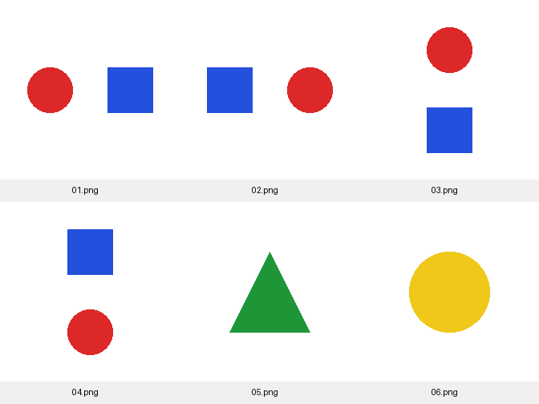

### Reasoning-Based Image Retrieval

Reasoning-Based Image Retrieval is a project for finding images from text descriptions that include spatial relationships or scene details. For example, a query such as "a red car behind a blue car" needs more than recognising the two cars.

The goal is to compare CLIP similarity search with a multimodal model that checks how well each retrieved image matches the query. The models are used without fine-tuning.

## Planned Approach

1. CLIP Retrieval: Convert images and text queries into embeddings, then rank the images by similarity.
2. Reasoning-Based Reranking: Use Qwen to check the objects and relationships in the retrieved images and reorder the results.
3. Evaluation: Compare the original CLIP rankings with the reranked results in terms of retrieval accuracy and computation time.

## Current Work

CLIP ViT-B/32 baseline and evaluation on a small set of labelled queries.

## How to Use

Run the following commands from the project folder with Python 3.10–3.12:

```bash
python3 -m venv .venv
source .venv/bin/activate
python -m pip install -r requirements.txt
python baseline.py
```

The first run downloads the CLIP weights (about 605 MB). The default uses CPU
and processes one image at a time. Add `--device mps` to try an available Apple GPU.

To search with a text query:

```bash
python baseline.py --query "A red circle to the left of a blue square."
```

The script prints the top three images and saves the full rankings to
`results/last_run.json`. Running without `--query` evaluates the labelled queries
in `practice/queries.json` and reports top-1 accuracy.

## Practice Examples



The six generated images are a small check of the retrieval pipeline, not a
research benchmark. Each query has one correct image. The recorded CPU run in
`example_run.json` scored 3/6: both object queries and one of the four spatial
queries. Qwen reranking has not been implemented yet.
